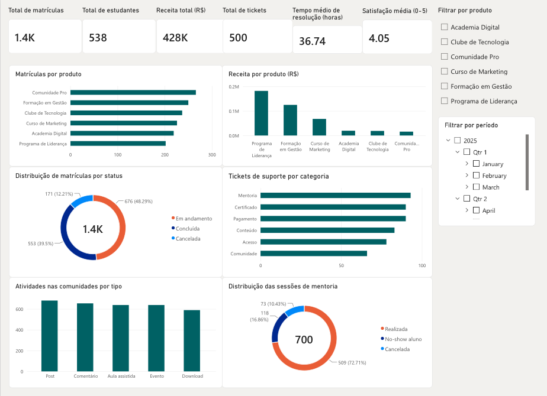

# Digital Operations BI – Portfolio

A Business Intelligence project developed with Power BI to analyze digital operations using a fully fictional dataset.

## About the Project

The goal of this project is to build an interactive dashboard to monitor operational performance and explore data related to digital products, enrollments, revenue, customer support, community engagement, and mentorship sessions.

The project simulates a digital education company managing multiple products and provides different perspectives on its operations through key performance indicators and interactive filters.

## Dashboard



## Key Performance Indicators (KPIs)

The dashboard includes six main KPIs:

- **Total Enrollments:** total number of recorded enrollments.
- **Students with Enrollments:** number of unique students with at least one enrollment.
- **Total Revenue:** sum of enrollment amounts.
- **Total Support Tickets:** total number of recorded support tickets.
- **Average Resolution Time:** average number of hours required to resolve support tickets.
- **Average Satisfaction Score:** average customer satisfaction rating.

## Available Analyses

The report includes six visualizations:

- Enrollments by Product.
- Revenue by Product.
- Enrollment Distribution by Status.
- Support Tickets by Category.
- Community Activities by Type.
- Mentorship Sessions by Status.

## Interactivity

The dashboard includes interactive filters to explore the data by:

- **Product:** select one or multiple digital products.
- **Date Range:** analyze data across different dates and periods.

The filters interact with the KPIs and charts, allowing users to explore results and compare operational performance across different criteria.

## Dataset

The project uses seven CSV files containing synthetic data:

| File | Description |
|---|---|
| `dim_products.csv` | Digital product information |
| `dim_students.csv` | Student information |
| `dim_date.csv` | Date dimension |
| `fact_enrollments.csv` | Enrollment and revenue records |
| `fact_community_activity.csv` | Community engagement activities |
| `fact_support_tickets.csv` | Customer support tickets |
| `fact_mentorship_sessions.csv` | Mentorship session records |

**Data disclaimer:** All data used in this project is fictional and was created exclusively for educational and portfolio purposes. It does not represent real customers, students, or business results.

## Tools and Technologies

- Power BI
- Power Query
- DAX
- CSV
- Data Modeling

## Project Structure

```text
power-bi-digital-operations/
│
├── digital-operations-bi.pbix
├── README.md
│
├── data/
│   ├── dim_products.csv
│   ├── dim_students.csv
│   ├── dim_date.csv
│   ├── fact_enrollments.csv
│   ├── fact_community_activity.csv
│   ├── fact_support_tickets.csv
│   └── fact_mentorship_sessions.csv
│
└── images/
    └── dashboard-overview.png
```

## Professional Purpose

This project is part of my portfolio in Digital Operations and Business Intelligence. It demonstrates practical skills in data organization, data modeling, KPI development, operational analysis, and interactive dashboard design.

